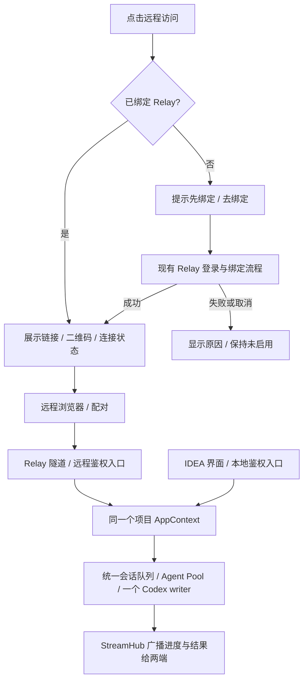

# 插件远程访问实施计划

用户于 2026-10-29 明确 approve 本方案，包含首版不移植原生语音等设备能力。实现按同目录 checklist 推进；批准不代表已经实现或通过联调，不自动绑定生产节点、提交或打包。

## 0. 术语约定

| 术语 | 本方案含义 |
| --- | --- |
| 插件 runtime | 插件随包提供、由 IDEA 项目启动的后端；本地与远程共用它 |
| 远程网页 | 复用 MindFS 网页交互、随插件提供的浏览器界面；不是另装一个 MindFS |
| Relay 绑定 | 将这个项目的 runtime 绑定到现有 Relay 服务；不是 Codex 会话绑定 |
| 浏览器配对 | 浏览器取得访问该节点的权限；与 Relay 账号登录、节点绑定分开 |
| 会话 / thread | 插件会话及其绑定的 Codex thread；两端使用同一个执行连接 |

已检查现有 `Relay.Status`、`Session`、`AgentBinding`、`IdeaWorkbench` 等命名，继续复用，不新建第二套会话模型。

## 1. 决策与约束

### 已确认的产品目标

- 用户只安装 IDEA 插件，不要求安装独立 MindFS，也不要求用户部署 Relay。
- 插件提供明显、常驻的“远程访问”按钮。未绑定时点击，明确提示“使用远程访问前，请先绑定 Relay”，提供“去绑定”；不能把入口藏在设置里。
- 已绑定时展示远程网址，提供打开浏览器、复制链接和二维码。绑定完成不等于浏览器已配对，也不等于隧道在线。
- 本地保留 IDEA 原生交互；远程复用 MindFS 现有网页能力，能够继续对话、查看及修改项目文件、查看 Diff、回答问题和审批、停止任务。
- 两端能够同时打开同一个会话，共用执行状态；首版要求电脑联网、IDEA 和对应项目 runtime 保持运行。

### 架构选择

一个项目 runtime 内共用 AppContext、Agent Pool、会话管理器和 StreamHub。本地入口与远程入口有各自的鉴权，最终进入同一套业务对象。远程端不启动第二个 Agent Pool，不通过独立 MindFS 恢复同一个 thread。

用户提供的 `already has an active writer` 明确说明 Codex 拒绝第二个写入者；已核实两份源码都通过独立客户端调用 `ResumeThread`。不通过删除锁、强杀进程、自动 fork 或新建会话掩盖这个冲突。

首版复用现有 Relay 协议和云服务，插件自身携带前端资源。项目之间分别保存节点凭据，避免多个 runtime 争用一个 Relay 节点。默认不启用远程；用户明确绑定后开启，重启恢复已保存的选择。关闭远程不停止本地 Agent；解绑先关闭远程通路，再按 Relay 既有能力撤销节点绑定。

用户于 2026-10-29 确认：已开启远程访问的项目，在 IDEA 打开该项目后自动启动同一 LocalRuntime 并恢复连接，不依赖首次打开插件面板；未开启的项目继续按需启动。读取设置和启动均在后台完成，不主动展开面板；项目关闭和插件卸载继续沿用现有服务退出流程。

### 明确不做

- 不要求、安装或自动启动独立 MindFS；不重写云 Relay，不实现本地服务域名转发。
- 不支持退出 IDEA 后后台运行，不建设新的多项目聚合服务；已有多个项目可各自绑定并通过现有节点列表选择。
- 不让远程页面管理其他本地项目、更新 runtime 或使用 Token Station；项目归属仍由 IDEA 决定。
- 不把远程浏览器变成 IDEA 远程桌面，不同步未保存的编辑器缓冲区；原生语音、控制台捕获等能力不默认承诺浏览器等价实现，见下方能力边界。
- 不修改用户真实会话用于破坏性测试，不更改 Codex 的单写入者规则。

走桌面插件加浏览器入口的默认复杂度，不引入后台守护进程或跨进程会话接管协议。

## 2. 名词与编排

### 2.1 名词层

**现状。** `runtime/server/internal/relay/manager.go` 的 `Status` 已提供绑定状态、节点地址、配对要求和错误，但没有足够字段证明 Connector 当前在线。`LocalOnly` 同时承担本地鉴权、禁用 Relay 和锁定项目；`runtime/web/src/services/ideaBridge.ts` 将 IDEA 模式固定为 true，混合了宿主能力与产品模式。

**变化。** 分开“项目由 IDEA 管理”“界面具有原生宿主”“远程访问是否开启”三个事实。入口来源由服务端受信任的路由/监听入口确定，不由浏览器参数或 `X-MindFS-Relayed` 单独授权。浏览器展示模式不影响后端项目权限。

| 契约 | 输入 → 可观察结果 |
| --- | --- |
| 远程访问面板 | 未绑定点击 → 绑定提示；点击去绑定 → 现有 Relay 绑定页；取消 → 保持未启用 |
| 绑定完成 | 后端确认凭据已保存 → 展示节点网址；连接未建立时显示连接中，不显示在线 |
| 访问状态 | 分别显示未绑定、已关闭、连接中、在线、断线/错误；在线来自实际连接生命周期 |
| 浏览器访问 | 未配对 → 最小配对页面；配对成功 → 当前项目；无权限 → 不返回会话和文件内容 |
| 远程管理 | 本地已鉴权用户可启停/解绑；远程业务入口不能修改绑定和配对管理配置 |
| 会话写入 | 两端发往同一会话 → 同一后端按接收顺序执行或排队，复用已有 Agent 连接 |

以上分别扩展现有 `Manager.Status/StartBinding`、bootstrap/E2EE、`StreamHub` 和原生工具栏命令；不另建通用工作台协议。绑定凭据和远程启用选择保存到当前项目的插件私有数据目录，不提交到项目仓库；节点凭据及 IDEA 私有令牌不进入链接、二维码或日志。

用户于 2026-10-29 追加要求：手机扫码后直接使用，不再手动输入密钥或二次确认。二维码改为访问网址加 `#mindfs_pairing=...`，携带当前配对密钥；浏览器读取后清除地址栏 fragment，按后端返回的 E2EE node ID 保存，再自动走既有加密握手。普通“复制链接”和“打开浏览器”地址仍不携带密钥，PC 初次使用保留手动配对。此版二维码等同访问凭证，使用当前长期配对密钥，不宣称一次性或短时有效；UI 明示不要转发。fragment 不进入 HTTP 请求和 Relay 访问日志。未取消后端鉴权，也没有改动 Relay 账号绑定。

**界面能力映射：**

| 能力 | IDEA 本地 | 远程网页 |
| --- | --- | --- |
| 新建、历史、会话切换、消息、活动详情 | 保留插件行为 | 复用同一业务数据和现有组件；保持两行活动状态 |
| 文件浏览与定位 | 原生编辑器 | MindFS FileViewer 和网页项目文件树 |
| 文件编辑 | 原生编辑器 | 复用 MindFS FileEditor 及匹配的读写/冲突校验契约，不能只搬 UI |
| Git Diff / 本轮快照 | 原生对比及现有聊天展示 | 网页对比；本轮仍使用固定快照，不能替换成当前 Git 差异 |
| 添加文件、代码上下文 | 当前文件和编辑器选择 | 网页选择文件或选取文本，复用已有上下文提交链路 |
| 审批、问题、停止、Plan 模式 | 当前插件行为 | 同一个后端的同一项待处理交互 |
| IDEA 控制台捕获、未保存缓冲区、原生语音 | 保留 | 首版建议不移植，不显示失效的原生按钮；远程文本编码流程完整可用 |

远程文件保存沿用 MindFS 已有冲突检测；文件已变化时明确报冲突，不无条件覆盖。IDEA 对磁盘外部改动使用原有刷新/冲突处理，不通过原生桥自动覆盖或保存未保存的编辑器内容。

### 2.2 编排层

**现状。** `runtime/server/cmd/idea-agent/main.go` 使用动态 loopback 端口并启用 `LocalOnly`；`runtime/server/app/server.go` 强制禁用 Relay，将同一个 mux 包在本地 Cookie 鉴权中，Relay 构造却仍拿到启动参数地址而非实际监听端口。Relay 健康检查不会带 IDEA Cookie。仅打开 Relay 开关无法连通。

**变化。** 保留本地入口，在同一 runtime 中增加只监听 loopback 的远程业务入口，供内置 Relay Connector 转发；两入口复用同一 AppContext 和业务处理器。Relay 使用远程入口的实际端口和最小健康检查。远程入口要求现有 E2EE/配对，静态页面与最小 bootstrap 例外不得泄露业务数据；本地入口继续使用 IDEA 私有鉴权，不要求 JCEF 重新配对。现有 E2EE 管理若影响全局 API，须按受信任入口区分鉴权策略，不能整体关闭加密。

远程前端与插件同版本发布，使用节点相对资源路径；不借用 MindFS 公共 `/mindfs-assets/` 目录，也不依赖伪造版本号避开重写。API、WS、懒加载资源和缓存均要验证节点前缀及跨项目隔离。

**并发与错误约束：**

- 发送准入与入队必须原子化。插件现有 `IsSessionReplying` 后再执行存在检查与执行分离；评估复用 MindFS `submitSessionMessage/reserveOrQueueSessionMessage`，不要只复用队列 UI。
- 两端同时回答同一问题/审批时，仅一次生效；另一端收到已处理状态。停止操作针对同一轮，不产生新的 thread。
- 两端可以各自查看不同会话，浏览器的切换不强制改变 IDEA 当前选中项；共享业务进度，不共享光标或未发送草稿。
- 重连恢复事件和最终状态，不擅自重发已接受消息。允许沿用现有 Connector 重连机制，不增加抢占写入者的重试。
- 若用户另开独立 MindFS 占用同一 thread，清楚报告 active writer 冲突，不承诺协调第三个独立服务。
- Relay 不可达、绑定失败、配对失败分别保留原因，本地会话继续可用。关闭远程后，现有远程 WS 和后续业务请求都失效。
- 浏览器关闭不停止任务；项目关闭/runtime 退出则节点离线，界面不能继续把断线误报为 Agent 正在处理。

### 2.3 挂载点清单

1. IDEA 工具栏：`AgentToolWindowFactory` 的 title actions / native command 注册新增“远程访问”，连到访问面板。
2. 项目私有配置：新增远程启用选择（默认 false），复用按项目保存的 Relay/E2EE 凭据；不修改用户会话存储结构。
3. runtime 生命周期：远程 loopback 入口与 Connector 的注册、启动和关闭，共用现有 AppContext。
4. 本地管理路由：接通绑定、状态、启停和解绑；远程入口排除管理能力。
5. 前端呈现入口：远程访问面板、浏览器宿主模式和网页文件操作的组件挂接。

移除这些挂接后退回本地插件流程；停用功能不删除会话、文件或 Agent 历史。

### 2.4 推进策略

以下步骤按同目录执行 checklist 推进。

| 顺序 | 工作 | 退出信号 |
| --- | --- | --- |
| 1 | 通路与鉴权骨架：测试环境接通 Relay、远程入口与共用后端 | 两个客户端读取同一测试会话；未配对请求被拒；本地无需新增配对 |
| 2 | 会话编排：统一发送准入、排队、待处理交互与广播 | 双端同时发送/回答/停止不会创建第二个 writer，不重复执行 |
| 3 | 入口交互：明显的按钮、绑定提示、面板、链接与二维码 | 未绑定必须先提示，绑定成功才提供节点地址，状态来自后端 |
| 4 | 网页能力：复用 MindFS 文件浏览/编辑/Diff，与插件会话展示对接 | 浏览器可完成发任务、补上下文、回答、查看及编辑文件的完整流程 |
| 5 | 持久化与生命周期：绑定恢复、关闭、解绑、断线恢复、项目隔离 | 重启保留绑定，关闭远程立即断开访问且不停止本地 Agent，多项目互不顶掉 |
| 6 | 双端联调与交付检查 | Windows/macOS 宿主与桌面/手机浏览器验收通过；review 和迁移回归通过后另行打包 |

### 2.5 结构健康度与微重构

**现状。** 本次检查没有找到 compound 下的目录归属规约，也没有既有远程访问 feature。`App.tsx` 约 1.59 万行，承担大量编排；`server.go` 476 行、`local_plugin.go` 126 行、`IdeaWorkbench.tsx` 150 行。`components` 有 59 个同层文件，`services` 62 个，`server/app` 7 个，Kotlin 宿主目录 21 个。

**结论：不做前置微重构。** 本次不为接远程重组整个 App 或目录。新增远程 UI/状态逻辑集中在功能目录中，原入口只挂接；后端入口鉴权放在 app 层已有职责边界，复用业务服务。MindFS 编辑能力按完整契约定向移植，不整仓同步。App 的整体拆分属于独立工作，不作为本功能前置。

## 3. 验收契约

| 场景 | 期望结果 |
| --- | --- |
| 全新机器只装插件 | 不依赖本机独立 MindFS，即可走绑定与远程流程 |
| 未绑定点击远程访问 | 显示约定提示与“去绑定”，无静默注册；取消后本地可用 |
| 已绑定点击 | 地址、复制、打开和二维码可用；断线不显示在线 |
| 只知道网址但未配对 | 只能进入配对流程，不能读文件/会话或执行任务 |
| IDEA 与浏览器打开同一 Codex 会话 | 同一个 thread 和执行连接，两端实时看到同一任务，无第二个 writer |
| 两端同时发送 | 原子准入、顺序执行/排队，消息不丢失不重复 |
| 两端同时回答/审批，以及一端停止 | 一次操作生效，两端终态一致，不残留“等待你的回答” |
| 断网再联网/页面刷新 | 恢复状态，不自动重复发消息；本地执行不因浏览器断开而取消 |
| 远程浏览、编辑、选代码、查看 Diff | 复用网页流程成功，无失效 IDEA 原生调用；本轮快照不随之后编辑变化 |
| 远程保存时文件已被本地修改 | 明确冲突，不覆盖新内容；不强行保存或替换 IDEA 未保存缓冲区 |
| Windows/macOS + 桌面/手机浏览器 | HTTPS/WSS、配对、文件路径、关键操作和二维码访问均可用；本地 Enter/IME 语义不回退 |
| 同时启用两个项目 | 节点凭据、数据、缓存隔离；一个项目不能经远程切到另一个未授权项目 |
| 关闭远程/解绑/关闭项目 | 按约定断开远程；关闭远程不停止本地任务，项目退出后节点离线 |
| 重启已绑定项目 | 复用该项目绑定和启用选择，不重复生成节点 |
| 旧版本用户升级 | 保留会话和任务，旧库迁移与重复启动均通过 |

反向核对：安装流程无独立 MindFS 依赖；无后台守护进程、writer 强抢/自动 fork、云服务域名扩展；远程无项目注册和 runtime 更新权限；无私有令牌/配对秘密进入普通访问链接和日志。

打包前必须执行项目 AGENTS.md 规定的 `go test ./server/internal/kanban -count=1` 与 `go test -race ./server/internal/kanban -run TestTaskStoreSnapshotMigration -count=1`（runtime 目录）。若涉及其他持久化结构，补相应旧数据验证。文档完成不等于这些检查已执行。

## 4. 与项目级架构文档的关系

验收后再将“项目 runtime 双入口、单执行后端、浏览器配对、入口鉴权边界和项目生命周期”提炼进 architecture；更新能力索引，将 remote-access 从 draft 转 current。现阶段不把未来设计写进现状地图。

### 实施前待核实，不扩大用户安装步骤

- 发布所用 Relay HTTPS 地址及其当前部署是否支持现有协议；沿用产品部署配置，不让普通用户配置服务器。当前源码比较不能替代线上联调。
- MindFS 网页编辑及依赖 API 的具体差异、E2EE 对本地入口的影响、浏览器缓存隔离，在步骤 1/4 验证；如果验证要求改变上述产品范围，先回到本方案讨论。
- 用户已批准首版不移植原生语音等设备能力；文件、Diff、上下文与 Agent 操作的网页适配属于首版必做。

### 证据基线

实施说明（2026-10-29）：已完成源码接入与本地验证，详见同目录 `remote-access-implementation.md`。保留 approved 状态，不将本地测试写成上线验收。

- 解绑复用既有云端能力：插件先关闭远程和现有远程连接，再明确引导打开 Relay `/nodes` 删除节点。现有删除接口要求云端登录态，插件设备令牌不能代替；本地关闭不显示为云端解绑成功。
- 本轮网页 Diff 使用会话已保存的 `update.diff` 逐文件并排展示，不读取之后的工作区内容；原生完整快照对比仍由 IDEA 承担。
- 首版文件编辑限项目内 UTF-8 文本、最大 1 MiB，沿用 MindFS 完整读写、revision 冲突检测及草稿保留契约。
- 未操作生产 Relay、真实用户会话或数据库；真实双端 Codex、Windows IDEA、公网和手机设备验收仍待完成。

- IDEA 仓库 `04efa59`；MindFS 仓库 `c5474ee`，仅作为本次源码调研基线，不代表已验证的线上版本。
- `runtime/server/cmd/idea-agent/main.go`、`runtime/server/app/server.go`、`local_plugin.go`：动态端口、本地鉴权和项目限制。
- `runtime/server/internal/agent/pool.go`、`agent/codex/session.go`、`api/stream_hub.go`、`api/ws.go`：进程内执行连接、订阅与排队。
- `runtime/server/internal/relay/manager.go`、`service.go`，`runtime/web/src/services/base.ts`、`e2ee.ts`：既有远程协议、节点路径和配对基础。
- MindFS `server/internal/api/ws.go`：原子准入与入队；`web/src/components/FileEditor.tsx`、`services/fileEditing.ts`：网页编辑与冲突语义。
- `src/main/kotlin/dev/ideaagent/AgentToolWindowFactory.kt`、`LocalRuntime.kt`，`runtime/web/src/layout/IdeaWorkbench.tsx`、`services/ideaBridge.ts`：原生入口、项目生命周期与宿主模式。
