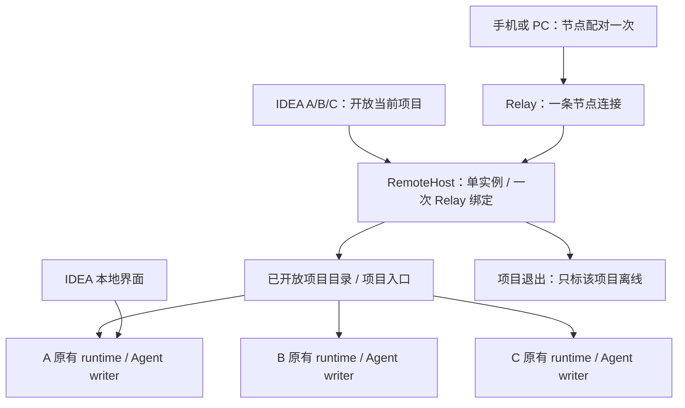

# 一个电脑节点，多个项目

本稿响应用户“这个体验很重要，你要先搞好设计”。用户于 2026-10-29 明确要求开始实现，本稿已批准。实现不操作线上节点，不改变已上传 0.1.25 的审核状态。旧版已批准设计保持历史原貌，本稿批准后替代其中“不建设项目聚合服务”的范围限制。

## 0. 术语约定

| 术语 | 本稿含义 |
| --- | --- |
| 电脑节点 | 同一电脑、同一操作系统用户的一份插件远程身份；跨 IDEA 窗口和进程，不按项目、IDE 安装版本新建 |
| 远程入口服务（RemoteHost） | 插件内置的本机协调进程，持有唯一 Relay Connector，列出开放项目并转发请求；不创建 Agent Pool |
| 项目运行服务（ProjectRuntime） | 当前 LocalRuntime 管理的项目进程；继续拥有 AppContext、队列、Agent 连接与广播 |
| 项目标识 projectId | 远程入口内的稳定、不暴露路径的项目标识；不同于现有 rootId（同名项目可能有相同 rootId） |
| 开放项目 | 用户已在该项目明确开启远程访问；不等于 IDEA 打开过的所有项目 |
| 浏览器配对 | 授权访问此电脑节点中已开放、以及之后由本机用户明确开放的项目 |

已检查本仓库及 MindFS 的 Relay Manager、Registry、E2EE 与前端路由；没有可直接使用的 RemoteHost 多进程聚合模块。MindFS 的项目列表适合复用交互，但其多个 root 共用一个 AppContext，不能直接替代本插件的多个项目进程。

## 1. 决策与约束

### 用户可见结果

首次在 A 点击远程访问 → 提示绑定这台电脑 → 完成一次绑定并开放 A → 显示访问链接与二维码。随后在 B、C 开放远程 → 直接加入同一电脑，无需再次绑定。

手机扫码一次进入 A，标题中可切换 A/B/C；从节点首页进入则看到项目列表。只开放 A/B 时，不显示 C。每个项目的入口保留当前项目深链接，日常扫码不用再找项目；同一个节点的网址可以收藏。

| 位置 | 已确认行为 |
| --- | --- |
| IDEA 远程面板 | 上方“这台电脑：已绑定 / 连接中 / 在线 / 连接失败”，下方“当前项目：允许远程访问” |
| 节点已绑定、当前项目未开放 | 显示“将当前项目加入远程访问”，不再次跳 Relay 绑定 |
| 常用操作 | 打开当前项目、复制当前项目链接、二维码；同时提供“全部项目”入口 |
| 关闭当前项目远程 | 只移除该项目并断开其远程连接，不停止本地任务，不影响其他项目 |
| 全局停用 | 在独立的电脑管理区操作“关闭这台电脑的远程访问”，明确影响全部项目；不删除绑定 |
| 浏览器项目选择 | 显示名称、可访问状态；同名项目增加父目录短标签，配对前不泄露名称/路径 |
| 项目未打开 / 启动失败 | 保留已开放项目的条目并显示原因，禁止发送；提示在 IDEA 打开 / 重试 |
| 项目切换 | 浏览器自行切换，不改变 IDEA 当前项目、会话、光标；任务继续运行 |

**已确认：**首版保留“逐项目主动开放”，不自动公开所有项目；已关闭项目不能从浏览器远程拉起 IDEA。节点作用域是当前系统用户，其他系统账号和另一台电脑各自拥有节点。

### 推荐架构与取舍

| 方案 | 结果 | 判断 |
| --- | --- | --- |
| 各项目共用 Relay 凭据并各自连接 | 云端同一 nodeId 的连接被替换，项目互相顶掉 | 不可采用，源码已有直接证据 |
| 所有项目改为一个业务 runtime | 需要重做会话存储、Agent Pool、原生桥归属及关闭语义 | 本次不选，影响已经稳定的执行链路 |
| 一个 RemoteHost + 原有多个 ProjectRuntime | 云端只有一条连接；项目继续各自执行，入口统一路由 | 推荐 |

RemoteHost 是插件携带的可执行程序运行模式，由插件自动启动，不额外安装 MindFS、不注册系统服务。它可以在启动它的 IDEA 窗口关闭后继续服务其他仍打开的项目，但最后一个参与项目退出后应自动结束。

跨进程协调是“一台电脑一个节点”的必要范围；不能仅用 IDEA application service 单例宣称跨进程共享。持久化与并发正确性按多进程档位处理，其余沿用现有桌面插件与浏览器默认复杂度。

### 明确不做

- 不把 Agent 执行迁入 RemoteHost，不接管或强抢 Codex writer，不启动另一份 MindFS。
- 不迁移项目会话、任务库、项目配置，不合并不同项目的 rootId 或 thread。
- 不扫描/发布全磁盘项目，不远程创建、删除或打开 IDEA 项目。
- 不提供 IDEA 全部退出后继续编码、系统自启动、多人项目角色权限或按浏览器分别授权项目。
- 不重写 Relay 云协议或替独立 MindFS 合并节点；不自动删除旧节点。

## 2. 名词与编排

### 2.1 名词层：现状 → 变化

**现状证据。** `LocalRuntime.kt` 是 PROJECT service；`RuntimeData.kt/runtimeDataDir` 按项目真实路径散列创建数据目录，`RuntimeProcess.kt` 将其传为 `IDE_AGENT_DATA_DIR`。Relay `device.go`、`credentials.go` 和 E2EE `config.go` 都使用此目录，因此设备、绑定和配对按项目独立。`server.go/Start` 给每个项目分别创建 AppContext、双入口和 Relay Manager。现有 rootId 来自项目 Registry，不保证跨 runtime 唯一。

**变化。** 引入以下跨模块契约，项目业务模型不变：

| 实体 / 状态 | 归属与内容 |
| --- | --- |
| RemoteHostIdentity | Windows `%APPDATA%/LocalAIAgent/remote`，macOS `~/Library/Application Support/LocalAIAgent/remote`，脱离 IDEA 版本配置目录；保存设备 ID、Relay 凭据、节点配对配置和全局启停选择 |
| ProjectRecord | RemoteHost 的项目目录：projectId、展示名、同名消歧标签、开放状态；真实路径仅本机使用，不对未配对客户端返回 |
| ProjectRegistration | 活进程登记：projectId、ownerInstanceId、协议版本、loopback 地址及独立登记凭证；地址与凭证不持久化为可复用授权 |
| ProjectAvailability | starting / online / closed / error；online 必须已完成业务入口就绪检查，不由“已注册”推断 |
| HostPresence | Relay 实际连接状态；与单项目可用状态分别显示 |

projectId 由统一入口维护的规范路径映射稳定分配；不同目录同名必须不同。规范路径需要覆盖 Windows 大小写、分隔符和 macOS 链接别名；不重写现有项目数据目录散列，避免升级后丢失历史。重启、IDE 升级不换标识；真正移动项目目录首版视为新项目，不猜测迁移关系。

**拟定外部路由示例：**

- `/n/N/` → 已配对后的项目选择页；未配对只有配对壳。
- `/n/N/p/P/` → 项目 P 工作台；首次扫码可携带既有 `#mindfs_pairing=...`，消费后清除。
- `GET /n/N/api/remote/projects` → 配对加密后返回 `[{project_id:"P",name:"A",availability:"online"}]`；未配对不返回列表。
- `POST /n/N/api/remote/projects/P/access` → 经节点配对验证后，加密返回 P 的独立 E2EE 身份和握手所需配对材料；未开放返回 404，已关闭返回 `project_offline`，不自动启服务。
- `/n/N/p/P/api/...`、`/n/N/p/P/ws` → 只转发给注册的 P；无法选择任意端口/地址；请求无效、P 未开放、P 离线分别明确失败。

来源：现有 `base.ts/appPath/wsURL`、`bootstrap.ts`、`e2ee.ts`、`remoteAccessMiddleware`。新增项目级前缀，不复用 `?root=` 充当跨进程路由；root 仍是业务 runtime 内部参数。

**本地控制契约：**插件/项目服务在受本机用户文件权限保护的控制通道中登记 P、撤销 P、设置开放状态、查询全局状态。示例：重复登记同一 owner+P → 幂等；另一活 owner 抢占 P → `project_owner_conflict`，原连接保持；登记版本不兼容 → `remote_protocol_incompatible`，本地插件继续可用。控制入口只接受受保护的本地连接，不暴露到 Relay，不接受浏览器传来的地址或标头作为登记依据。

### 2.2 编排层：现状 → 变化

**现状。** 每个项目启动自己的 Connector，云端 `connector.Registry.Register` 按 nodeId 替换旧连接。前端 URL 与证明路径只处理 `/n/N`；多个 runtime 不共享进程内队列与广播。

**变化。** 只有 RemoteHost 启动 Connector；项目远程入口继续使用同一个 AppContext，与本地界面共享原有单 writer、排队和完成广播。聚合只处理访问路由，不将广播、排队、重试或消息确认搬到入口服务。

#### 单实例与生命周期

1. 需要远程的插件先连接当前用户已运行的 RemoteHost；不存在才在跨进程启动互斥保护下启动。服务自身持有 OS 进程锁至退出，启动完成才发布控制地址、版本、进程世代和秘密，客户端必须鉴权握手核验，不能仅凭 PID/端口/旧文件复用。
2. 多个 IDEA 进程同时启动时只有一个 Connector、一个凭据写入者。不同协议版本不允许启动第二个争用同一身份的入口；显示需要统一插件版本，本地业务不受影响。
3. 参与项目保持本地活连接/租约，正常关闭先撤销入口并关闭其现有远程 WS、在途传输，再按原生命周期退出项目 runtime。浏览器关闭或切换项目不撤销 runtime。
4. 异常失联按租约标记不可用；建议心跳 5 秒、20 秒失联判定、无参与项目 30 秒退出，作为首版可验证上限。短暂宽限期内节点可在线但没有可访问项目，不能伪报项目仍在线。
5. RemoteHost 不依赖第一个项目的 stdin/父进程存活。启动方退出不得杀掉其他项目共用的服务；项目卸载仅撤销自己登记，最后一个登记离开后才整体退出。
6. RemoteHost 异常退出：项目业务继续运行；仍有参与项目时插件通过同一启动互斥恢复入口，重新登记，复用节点身份。按明确的退避策略控制恢复频率，持续失败显示错误和重试入口；绝不因“重连”重发业务消息或恢复第二个 thread。
7. 同路径被两个 IDEA 进程打开时，本功能拒绝第二个远程 owner，不静默切换。它不解决两个独立本地 runtime 本来就可能竞争 CLI thread 的问题，也不承诺跨 IDE 原生会话接管。

#### 配对、加密和路由边界

推荐保留项目原有 E2EE，RemoteHost 只对项目目录与访问材料提供节点级加密接口，业务 HTTP/WS 密文透传。这样不需要重新实现所有消息帧的解密/加密，也不把远程请求伪装成本地 IDEA 请求。

- 用户只做一次节点配对。浏览器访问 P 时，先用节点会话取得 P 的访问材料，再自动建立 P 的现有 E2EE 会话；切到 Q 同理，不再次让用户输入。
- 节点和项目使用两个明确独立的客户端加密上下文，各有 base URL、node ID、client ID 和会话状态。不能沿用一个全局 singleton 随意换密钥；项目材料仅在页面内存保留，长期浏览器授权只保存节点配对凭据。
- 项目迁入新模式时创建独立的新项目远程 E2EE 身份，保存在项目私有远程配置中，不沿用旧版二维码对应的身份和密钥；旧配置仅为明确回退保留。否则旧 A 密钥仍可能绕过节点配对直接握手 A 的新路由，不能宣称旧权限已被隔离。
- 项目配对材料只通过鉴权后的节点 E2EE 响应传输，不放 URL/query、二维码、项目列表、日志或静态资源；项目注册给 RemoteHost 的材料也只走受保护本地控制通道。RemoteHost 是本机受信任组件，不宣称它不知道项目密钥。
- Relay 去掉 `/n/N` 后转发 `/p/P/...`；RemoteHost 将该原始路径原样转发至 P。项目入口先核验固定 projectId，再为业务路由去掉前缀，但请求证明必须使用可信入口保留的原始转义路径及 query，包含 `/p/P`。不得从浏览器提供的 forwarded-path 标头构造证明路径，避免跨项目替换和编码差异。
- 请求路径与元数据仍可能被 Relay 看到，不夸大加密范围。`%2F`、中文、空格、query 和 WS upgrade 必须以同一契约处理。
- 新模式中项目远程 loopback 入口只允许 RemoteHost 的独立凭证进入，之后仍执行项目 E2EE 与现有远程路由限制；凭证不复用 IDEA native token，不授予 LocalIDEAccess。这样即使已取得某个旧项目密钥，也不能绕过全局停用直连 loopback。
- 全局停用或项目撤销必须同时拒绝新路由并关闭对应现存 HTTP/WS 通路；项目 runtime 也撤销入口授权。旧版独立 Connector 在迁入新模式后不得继续运行。

#### 页面切换和缓存

首版项目切换采用完整页面导航，卸载上一项目 App 和 WS，避免巨型 App 热切换残留上一项目的待处理回复、文件和模型选择。关闭 WS 不取消任务；重返项目走现有事件回放和终态恢复，不自动重发消息。

节点入口页与项目工作台边界分开。API、WS、懒加载资源、下载地址均识别 `/n/N/p/P/`；项目前端资源使用对应 runtime 版本，不拿入口版本强行覆盖。

缓存与草稿统一以 `(hostIdentity, projectId, rootId, sessionId/filePath)` 适用字段隔离，节点配对独立存储。聊天未发送草稿在同一浏览器标签中切换项目后恢复；未保存文件编辑先明确提示“继续编辑 / 放弃并切换”，不得静默丢失或跨项目带入。刷新、前进后退、直接打开深链接均重新核验项目状态。已有权限失败时不继续呈现缓存敏感内容。

项目列表在进入/返回选择器时主动刷新，展示期间按租约节奏更新，项目路由本身始终检查实时可用状态；列表不是授权依据。不增加“所有项目运行任务汇总”等需要跨进程复制业务状态的首版功能。

#### 旧版升级（推荐的简化迁移）

0.1.25 的旧二维码只授权一个项目，不能复制成节点级授权，否则曾持有 A 二维码的人会自动获得 B/C 权限。

推荐升级时**一次性建立新的电脑节点并重新扫码一次**，而不是自动继承某一个旧项目的配对权限。界面明确：“远程访问升级为电脑入口；原有会话保留，需绑定一次并重新扫码。”

- 未使用远程的用户不触发绑定；已有远程的用户由本机确认迁入统一入口，不能后台静默扩权。
- 新入口绑定失败时保留旧模式和旧配置，不先破坏可用入口。成功切换时先停该项目旧 Connector、关闭旧远程连接，再登记新入口；切换完成才持久化迁移标记，失败清楚显示状态，可按记录恢复旧模式，不双连。
- 旧 `remote-access.json.enabled` 作为该项目是否已开放的迁移输入；后续已迁移项目首次启动时幂等加入已建立的统一入口，不再次创建节点。尚未迁移的旧项目在本机面板明确确认加入现有电脑入口，复用已经完成的绑定；不把旧节点的 enabled 静默解释为允许所有电脑级浏览器访问。关闭全局远程不抹掉各项目开放选择。
- 项目历史、任务库、CLI thread、IDE 配置位置原样保留。仅新增全局远程目录和迁移记录，不复制真实数据库。
- 其他旧节点不自动删除：已升级并迁移的项目旧节点离线；未打开/未升级的项目可能仍保留旧模式，因此不能宣称云端立刻只剩一个节点。提供 Relay 节点管理入口，明确旧收藏/二维码不会自动跳到新入口。
- 不支持新旧插件并行打开同一项目进行迁移；检测到活跃旧 owner 时提示先关闭/升级，不能抢其连接。未能确认独占旧配置时不自动迁移。

此取舍增加一次升级绑定/扫码，但避免跨项目授权扩张、多个已有 Relay 账号归属不明以及旧 Connector 抢占新入口。备选“选一个旧节点继承地址”需要排他移交和重新配对，范围更大，本稿不推荐。

### 2.3 挂载点清单

1. 插件远程生命周期：在现有项目启动/关闭/卸载挂接中加入 RemoteHost 获取、登记与撤销，保留 LocalRuntime 执行归属。
2. 当前 OS 用户全局远程配置及本机控制入口：新增唯一身份、启停状态、项目开放目录、版本化迁移记录；项目业务持久化不变。
3. 远程路由：新增节点目录与项目路由、项目受控入口，接替项目独立 Connector；保留浏览器远程权限限制。
4. IDEA 远程面板及浏览器入口：区分全局绑定/当前项目开放，新增项目选择、深链接与切换导航。
5. 浏览器 bootstrap/资源与存储作用域：节点配对、项目自动握手、projectId 路由和缓存隔离。

停用上述入口并退出 RemoteHost 后，本地插件仍可独立运行；不删除项目数据。回退旧二进制前必须停止新入口并恢复明确的旧模式配置，不能让两套 Connector 同时拥有同一项目入口。

### 2.4 推进策略

| 顺序 | 编排切片 | 退出信号 |
| --- | --- | --- |
| 1 | 本地多进程入口骨架与所有权 | A/B/C 并发登记只有一个 host；关闭启动方 A 不影响 B/C；重复 owner 被明确拒绝 |
| 2 | Relay 单连接、目录与加密路由 | 一个测试节点访问两个独立 runtime；未配对不可列项目，跨项目请求篡改失败 |
| 3 | 持久化、恢复与升级状态机 | 重启复用身份；异常退出恢复不重发消息；旧节点不会静默扩权，迁移中断可恢复 |
| 4 | 项目面板、选择页与完整导航 | 一次扫码切换 A/B/C；无额外绑定；同名项目、离线提示、草稿/文件切换语义正确 |
| 5 | 三端业务与关闭边界 | 原有排队/问题/停止/完成回放仍正确；关闭 P 只撤销 P；全局停用全部失效 |
| 6 | 全量复核与交付准备 | 下方场景具备证据；Windows/macOS 多窗口及不同 IDEA 进程验证；打包前迁移检查通过 |

### 2.5 结构健康度与微重构

现状检查：`.codestable/compound` 和 `.codestable/reference` 不存在，没有可复用的目录 convention。`App.tsx` 15935 行、`server.go` 509 行、Relay `service.go` 747 行、`LocalRuntime.kt` 152 行；app/relay/Kotlin 目录分别有 10/9/23 个同层文件，远程组件目录 4 个。

**结论：不做前置微重构。** 新的 RemoteHost 属于新增职责，放在独立功能边界；前端项目选择与节点 bootstrap 放远程功能目录，既有 App 只负责已选项目工作台。后端入口组织、Kotlin 跨进程连接按远程子目录归属，避免继续堆平目录。E2EE 客户端需支持明确的实例作用域，这是本功能行为变更，不能伪称纯搬代码。App 整体拆分、Relay 全面重构不作为前置任务。

## 3. 验收契约

| 输入 / 触发 | 可观察结果 |
| --- | --- |
| 全新用户 A/B/C 依次开放 | 完成一次 Relay 绑定，云端只新增一个节点；三个项目各一次加入，无第二份安装 |
| 同一用户多 IDEA 窗口/进程同时启用 | 一个 RemoteHost、一个 Connector、一个绑定流程，不重复生成身份 |
| 重启、IDE 升级、退出再打开 | 同一节点与项目标识；旧项目历史和配置可读写 |
| A 首先启动入口，之后关闭 A | A 离线；B/C 正常发送与实时同步，无全节点断线 |
| 所有参与项目退出 / 异常死亡 | 在约定租约与退出期限内节点离线，进程不长期遗留 |
| 手机扫码 A，切换 B，再回 A | 不再次输入密钥；两项目内容、草稿、缓存与终态正确，无跨项目数据混入 |
| C 未开放 / P 主动关闭远程 | C 不列出；P 已开 WS 和新请求都失效；A/B 及本地任务不受影响 |
| 全局远程关闭 | 全节点业务不可访问，原有远程连接失效，配对缓存不能绕过，本地可用 |
| 两个同名目录 / Windows 路径别名 | 不同真实项目分离，同项目别名不重复登记；已有数据路径不变 |
| 两个进程登记同一项目 | 第二个得到冲突提示，不抢第一个，不由 host 创建第二 writer |
| 断网 / host 重启 / WS 重连 | 清楚显示状态并恢复；不重复接受、执行用户消息，不清空有效配对 |
| 篡改 P、端口、路径编码、管理路由 | 拒绝越权/任意代理；HTTP/WS 签名绑定目标项目；无远程 IDEA token 通道 |
| 未配对访问 / 旧 A 配对材料访问新节点 | 看不到项目列表与业务内容，不能取得 B 的访问材料 |
| 升级绑定失败 / 切换中断 / 再次启动 | 旧数据完整，模式状态可辨，迁移幂等；同一项目不双连 |
| 多个旧节点分属不同账号 | 不静默挑一个继承或合并；用户明确绑定新统一节点 |
| 不兼容插件版本同时运行 | 不出现第二个同身份 host；明确升级提示，本地项目仍可工作 |
| 文件未保存时切换 / 返回 / 刷新 | 提示不会静默丢改动；恢复项目后无串草稿、串文件、串会话 |
| IDEA/浏览器/手机操作同一会话 | 原有单 writer、消息顺序、一次回答、停止、完成回放全部保持 |

反向核对：没有系统服务安装、全盘项目扫描、云端协议变更、会话数据库迁移、Thread 强抢、自动删除旧节点、浏览器私自登记项目；不宣称脱离 IDEA 可继续工作。

实现阶段必须验证本地受保护目录在 Windows/macOS 的权限、跨进程锁与崩溃释放、Relay 部署实际透传嵌套路径及静态资源、现有 E2EE 实例化后的 HTTP/WS 契约。源码调研不能替代这些验证。若验证推翻路由/鉴权设计，应回到本稿调整，不用关闭鉴权、复制全局配置或增加第二 Connector 兜底。

打包前仍执行 AGENTS.md 的 kanban 全包测试及 `TestTaskStoreSnapshotMigration` race 测试；新增远程配置提供旧版、重复迁移与中断恢复用例。当前仅文档设计，未执行这些实现验收。

## 4. 与项目级架构文档的关系

批准并实现后，更新 remote-access requirement 中旧“分别开启/不聚合”边界，验收时将电脑身份、项目 owner、单 Connector、双层配对、加密路由和租约退出提炼到 architecture。现阶段不把草案写成已实现现状，不覆盖 0.1.25 的设计与验收历史。

证据基线：IDEA 仓库 `5590b55`；同级 MindFS 的 `cloud/internal/connector/registry.go` 和 `cloud/internal/gateway/http.go` 仅作本地源码参考，未验证线上部署版本。用户已批准实施；逐项目主动开放、电脑升级一次新绑定/扫码，以及项目关闭后不提供远程启动均作为实现边界。
