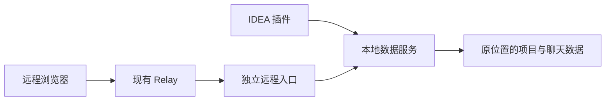

# 独立远程与本地数据服务

2026-11-12 生命周期修订：用户明确要求“IDEA 关闭后远程仍可聊天”和“独立远程停止或故障不影响本地聊天”同时成立。下文安装、升级、注销停止两端及移除 Core 自启的条款描述当前实现，违反此次明确的隔离要求，不能作为后续实施依据。修订方向为分离聊天运行时与远程包的资源和生命周期归属，具体方案待确认；本轮未修改生产代码或运行环境。核对结果见 [计划与进度](README.md)。

本设计以用户 2026-11-11 对故障边界的纠正为准，替代旧版“插件主启动依赖远程服务”的方案。完成状态见 [计划与进度](README.md)。

## 功能约束

独立优先仅用于远程功能。远程入口停止、连接失败或认证失败，插件界面、聊天和本地操作继续运行。浏览器保留现有多项目界面，IDEA 从项目 A 进入定位到 A；IDEA 关闭后远程服务仍可用。独立安装可选，未安装时使用原内置后端。

## 实现

- `core.json` 保存本地数据服务的回环地址和私有凭据，服务复用现有 AppContext、多项目 Registry、Agent Pool 和 Web UI。
- `host.json` 保存远程入口地址和凭据。远程入口只管理 Relay、远程启停和转发；不拥有项目数据写入逻辑。
- 数据服务持有排他 `backend.lock`，原内置项目进程继续持有共享锁，保持同一数据的唯一运行模式。远程入口单独持有 `host.lock`。
- IDEA 通过自带程序启动或复用数据服务，再调用其 `open-project`。远程入口不可用不会参与此启动判断。多个项目同时打开时串行创建共享数据服务。
- 远程入口重启只更换自己的凭据，IDEA 连接的数据服务地址和令牌保持不变。
- 本地浏览器使用 HttpOnly Cookie；远程请求沿用现有 Relay 协议，通过独立回环入口转发普通 HTTP/JSON 和 WebSocket。远程访问不能调用本地控制和管理接口。
- 远程面板中的启停操作只发送局部状态事件，不销毁或重新挂载插件 JCEF 页面。
- 启动和重启沿用上次实际端口，显式 `-addr` 优先。

## 数据与安装

保留已有一次性项目导入、目录去重、home 元数据位置、旧书签跳转和 Relay 身份。聊天和附件不复制到新位置。插件按用户点击调用同源安装脚本升级独立服务；在线与离线安装脚本更新程序时会停止远程入口和数据服务，然后保留全部项目数据。

`.15` 插件和 `.6` 独立版作为本轮配套测试包；旧 `.3` 是单进程实现，升级时需同时更新。普通 `-stop`/`-restart` 只控制远程入口，安装程序通过 `-stop-core` 更新本地数据服务；`-unregister` 结束两端并移除安装记录。

## 验收

- 远程缺失、关闭、启动失败和认证失败期间，本地页面、数据读写和原 WebSocket 连接可用。
- 远程重启不更换本地令牌、不创建第二个数据写入进程。
- 远程入口仍可复用原 Relay 身份，登录后无需配对即可查询项目，保留旧链接定位。
- 两项强制旧库迁移、相关 Go/race、前端及 Kotlin 检查通过；核对配套包的版本、架构和资源。

## 2026-11-12 认证决策更新

用户明确云端不能更新（已接入其他客户端）。现有 Relay 保持原样，撤回云端登录转发修改；当前节点转发不检查浏览器登录，节点地址可直接访问已开放项目。IDEA/独立版取消浏览器 E2EE 配对、带密钥链接和项目二次授权。此前要求保留或迁移浏览器配对身份的设计作废；历史文件保留但不参与认证。本地进程控制凭据及数据写入排他锁继续使用。

## 分发约束（2026-11-12）

独立版只提供后台程序和 Shell / PowerShell 安装升级脚本。用户明确取消额外的 macOS 管理应用与图形安装器；macOS / Linux 使用 tar.gz，Windows 使用 ZIP。

## macOS 后台常驻（2026-11-12）

安装脚本自动配置用户 LaunchAgent，无需用户手动执行 launchctl。Core 和 Gateway 分别在登录后启动、异常退出恢复；手动停止远程不影响 Core。更新脚本停止两端再替换并启动，注销删除自启配置。离线分发提供单文件自解压 Shell 安装器，保留 tar.gz 供在线安装脚本下载。

## Windows 常驻与正式测试分发（2026-11-12）

Windows 安装脚本自动注册当前用户的两个计划任务，Core/Gateway 分别管理。使用登录触发器、当前用户普通权限、无运行时长限制和失败重启策略；隐藏 PowerShell runner 透传退出码并追加日志。安装或升级停止两端、替换程序、重新注册并启动；普通停止远程保持 Core 运行，注销移除两个任务。线上测试入口作为固定版本 Release 资产发布，脚本自行下载和校验 ZIP，用户无需解压或配置计划任务。

## 远程模式选择（2026-11-12，用户确认）

首次打开远程面板提供内置/独立选择，默认当前有效模式；面板持续提供修改入口。选择保存到用户级 backend-preference.json，当次 IDEA 中所有项目保持原连接，下次启动生效。未安装独立版时显示安装步骤，使用已发布脚本；安装之前本地仍使用内置。安装记录保留，切回内置不删除独立程序和聊天数据。

IDEA 进程持有用户级共享会话锁；仍有其他 IDEA 实例运行时，新实例沿用有效模式，提示重启所有 IDEA。仅无其他实例时进行交接：切回内置正常停止 Core 并移除其自启，远程清理失败只影响远程；切到独立恢复自启和远程入口，本地 Core 启动不依赖远程成功。数据锁继续防止重复写入。

## 2026-11-12 已确认：首次选择与重启生效

首次打开远程面板确认内置/独立方式，后续在同一面板修改。用户明确接受重启 IDEA 生效，保存只写用户级偏好，不停止服务或重载页面。进程级模式会话在项目间复用；其他 IDEA 实例仍持有共享会话锁时不交接。切换协调数据写入权及系统自启，项目身份和原元数据位置保持。首次安装需要退出 IDEA 后运行面板提供的安装脚本，安装器认证停止退出后尚驻留的内置入口。

## 2026-11-12 交互修订：面板安装

用户要求先检测独立服务，未安装时在面板一键安装，再进入远程界面。复制命令改为插件后台运行同源安装脚本；安装下载校验由原脚本负责，新增延后启动方式仅允许新装，不替换正在使用的程序。当前聊天和进程不切换，重启后交接。选择/安装/待重启阶段不展示旧模式远程状态；生效后显示远程连接和测试入口，使用方式收起为当前状态与“更改”。

## 2026-11-12 交互修订：插件内更新

打开远程入口时，插件运行已安装程序的 `-version`，与插件配套版本比较；只有较旧版本才提供更新，不自动降级。提示与按钮位于插件的原生区域，因此连接旧独立后台提供的网页时也可用。点击“更新并重启 IDEA”后，复用同源在线安装器的正常升级路径：下载和校验完成后停止两端、替换并启动，成功后正常重启 IDEA，再打开原项目远程设置。更新期间显示进度，失败保留详情并提供重试；用户无需终端、解压或手动控制服务。更新会中断后台连接，按钮旁提示先完成当前回复。首次安装继续使用延后启动方式，不改变原模式偏好。
